# 专八听力片头音乐剪切核验

仅核验并给出剪点；本脚本没有剪写成品音频、调整增益、重采样或改声道。剪点绑定“原音准备.json”的canonical WAV SHA256，基准为未剪原音秒数。

2009—2015有片头音乐；其余已核年份没有音乐，保留start=0。2022按总协调要求等待完整新源，本轮不对旧缺头源给出通过结论。

能量表中的-240dBFS为对数显示下限；对应片段PCM全为0，并非实测到了-240dBFS的非零声音。JSON另外以digital_zero标记。

方法：逐年人工查看原采样率PCM的波形及STFT频谱；音乐段可见连续谐波、持续旋律结构与渐弱尾部。剪点放在音乐结束后、语音开始前的实际低能量间隙，随后用全声道峰值/RMS复核。ASR首词只用于交叉定位，不作为裁切依据。没有音乐的源保留全部前导静音或底噪。

|年份|音乐|剪点（秒）|原采样率/声道|核验静音区间（秒）|剪点±40ms峰值|ASR Test参考（非剪点）|
|---|---|---:|---|---|---:|---:|
|2009|有|13.20|22050Hz/2声道|[13.06, 13.37]|-75.42dBFS|14.72|
|2010|有|14.22|44100Hz/2声道|[13.95, 14.49]|-240.00dBFS|14.91|
|2011|有|14.19|44100Hz/2声道|[13.85, 14.53]|-240.00dBFS|14.89|
|2012|有|13.18|44100Hz/2声道|[13.02, 13.35]|-74.64dBFS|14.00|
|2013|有|14.24|44100Hz/2声道|[13.82, 14.67]|-240.00dBFS|14.69|
|2014|有|13.16|44100Hz/2声道|[12.99, 13.33]|-76.86dBFS|14.48|
|2015|有|13.14|44100Hz/2声道|[12.97, 13.32]|-82.15dBFS|14.16|
|2016|无|0.00|44100Hz/2声道|不剪切|-240.00dBFS|2.72|
|2017|无|0.00|44100Hz/1声道|不剪切|-240.00dBFS|4.08|
|2018|无|0.00|48000Hz/2声道|不剪切|-240.00dBFS|1.76|
|2019|无|0.00|44100Hz/2声道|不剪切|-240.00dBFS|0.96|
|2021|无|0.00|44100Hz/2声道|不剪切|-240.00dBFS|1.28|
|2023|无|0.00|44100Hz/2声道|不剪切|-58.91dBFS|1.60|
|2024|无|0.00|24000Hz/2声道|不剪切|-240.00dBFS|1.12|

## 2009

逐年查看0—20s原采样率波形和0—6kHz频谱：约1.7—13s存在连续音乐谐波及旋律变化，结束后频谱进入低能量间隙；13.06—13.37s全声道峰值低于-60dBFS，选择间隙内13.20s（原样本291060）裁去片头音乐。剪点前后40ms峰值-75.42dBFS、RMS -90.35dBFS；正式报幕Test的ASR参考起点14.72s，剪点早于该参考1.52s。已按波形/频谱确认没有剪入报幕音节；不是按ASR首字起点切割。保留报幕、正式说明及其后全部内容。

canonical SHA256: `af0fc28b7b3c9a7e04f77ba715e78c426233395dcdfbbd1ab834c1951b19a8e0`
原压缩文件 SHA256: `370f16bfd0d814ddbc1551e7b21c282a39d6964ed59da2af99dd351d677dd6e6`

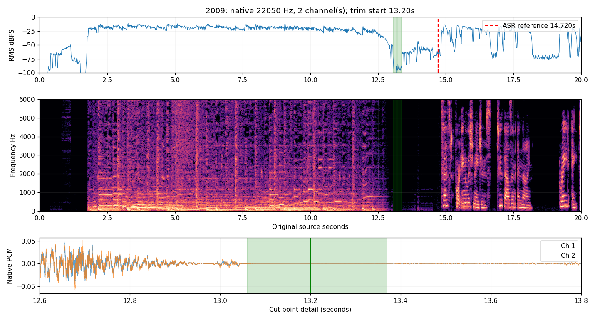

## 2010

逐年查看0—20s原采样率波形和0—6kHz频谱：约1.7—13s存在连续音乐谐波及旋律变化，结束后频谱进入低能量间隙；13.95—14.49s全声道峰值低于-60dBFS，选择间隙内14.22s（原样本627102）裁去片头音乐。剪点前后40ms峰值-240.00dBFS、RMS -240.00dBFS；正式报幕Test的ASR参考起点14.91s，剪点早于该参考0.69s。已按波形/频谱确认没有剪入报幕音节；不是按ASR首字起点切割。保留报幕、正式说明及其后全部内容。

canonical SHA256: `e8edfe4a8bc7c81033d2e413058ec086d382d50b01bb5b6b9a29a434ce8430eb`
原压缩文件 SHA256: `c525c22d74a77cd291471be15af79e4d58da94477aeb48e4126911e0dc61926c`

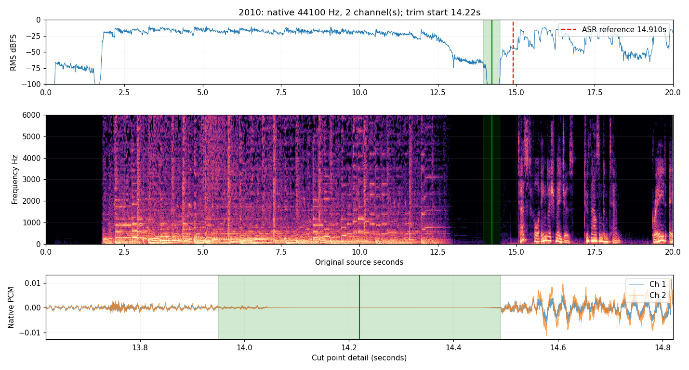

## 2011

逐年查看0—20s原采样率波形和0—6kHz频谱：约1.7—13s存在连续音乐谐波及旋律变化，结束后频谱进入低能量间隙；13.85—14.53s全声道峰值低于-60dBFS，选择间隙内14.19s（原样本625779）裁去片头音乐。剪点前后40ms峰值-240.00dBFS、RMS -240.00dBFS；正式报幕Test的ASR参考起点14.89s，剪点早于该参考0.70s。已按波形/频谱确认没有剪入报幕音节；不是按ASR首字起点切割。保留报幕、正式说明及其后全部内容。

canonical SHA256: `45b5db31307efc196305275dd352a330740fbf1e4429429aaa78ba2c0b42f289`
原压缩文件 SHA256: `c5b0784b329e6d88cbc8e309da47eec69eb8f4aa1d33778a04a347da34ee8462`

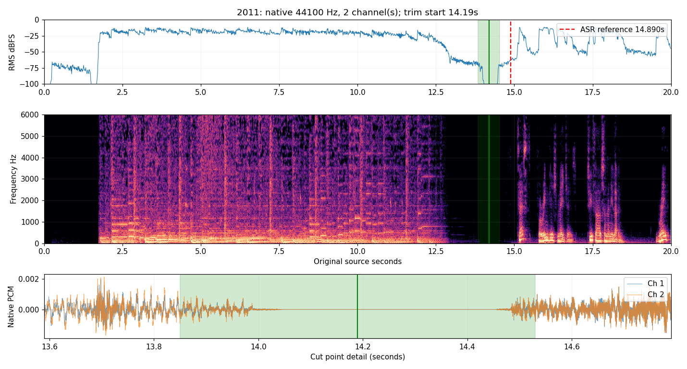

## 2012

逐年查看0—20s原采样率波形和0—6kHz频谱：约1.7—13s存在连续音乐谐波及旋律变化，结束后频谱进入低能量间隙；13.02—13.35s全声道峰值低于-60dBFS，选择间隙内13.18s（原样本581238）裁去片头音乐。剪点前后40ms峰值-74.64dBFS、RMS -89.15dBFS；正式报幕Test的ASR参考起点14.00s，剪点早于该参考0.82s。已按波形/频谱确认没有剪入报幕音节；不是按ASR首字起点切割。保留报幕、正式说明及其后全部内容。

canonical SHA256: `2036d321ae8c2ea334df2b6494db90e6995b61c070cdc28a6cdd3f2529fd2dca`
原压缩文件 SHA256: `76493b3a0a9159a391a51d0c914dfa49d5123bdfc36a8783f7c6491a3940989c`

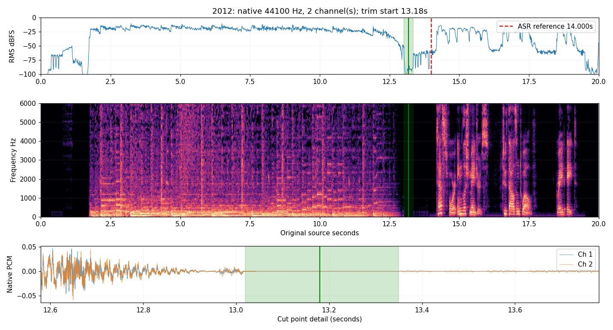

## 2013

逐年查看0—20s原采样率波形和0—6kHz频谱：约1.7—13s存在连续音乐谐波及旋律变化，结束后频谱进入低能量间隙；13.82—14.67s全声道峰值低于-60dBFS，选择间隙内14.24s（原样本627984）裁去片头音乐。剪点前后40ms峰值-240.00dBFS、RMS -240.00dBFS；正式报幕Test的ASR参考起点14.69s，剪点早于该参考0.45s。已按波形/频谱确认没有剪入报幕音节；不是按ASR首字起点切割。保留报幕、正式说明及其后全部内容。

canonical SHA256: `2106a911776b6a968a8d3e336a7c006c171acc74aa72494e9f0e4ca51e9cea6f`
原压缩文件 SHA256: `a76ba4b63f49124c871b0cfdbfb221ce644c104d1cc9c9464d4696a4c68cf186`

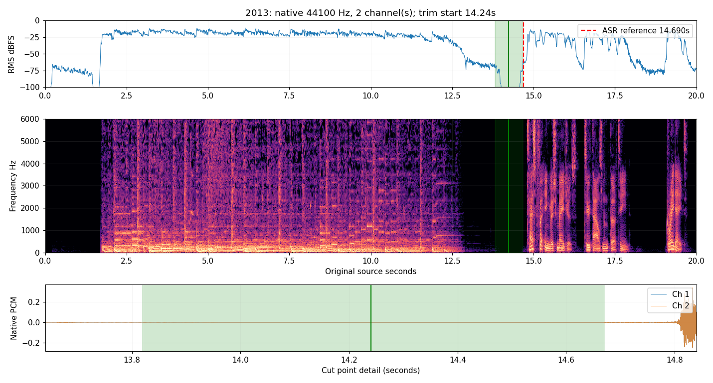

## 2014

逐年查看0—20s原采样率波形和0—6kHz频谱：约1.7—13s存在连续音乐谐波及旋律变化，结束后频谱进入低能量间隙；12.99—13.33s全声道峰值低于-60dBFS，选择间隙内13.16s（原样本580356）裁去片头音乐。剪点前后40ms峰值-76.86dBFS、RMS -92.12dBFS；正式报幕Test的ASR参考起点14.48s，剪点早于该参考1.32s。已按波形/频谱确认没有剪入报幕音节；不是按ASR首字起点切割。保留报幕、正式说明及其后全部内容。

canonical SHA256: `48626f7e4bd715ab94fcdc1cc948a8f5e38b0ffe3dc5e94e2491bb8ee53188db`
原压缩文件 SHA256: `52d6c87ad219b66540554d3f1d72935cbea988497d2097141fa2095ba4deb739`

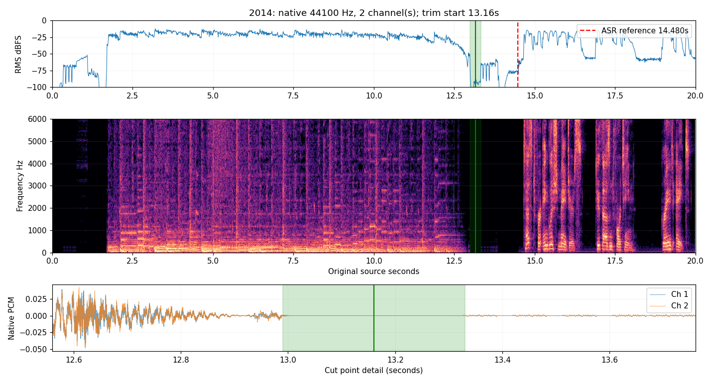

## 2015

逐年查看0—20s原采样率波形和0—6kHz频谱：约1.7—13s存在连续音乐谐波及旋律变化，结束后频谱进入低能量间隙；12.97—13.32s全声道峰值低于-60dBFS，选择间隙内13.14s（原样本579474）裁去片头音乐。剪点前后40ms峰值-82.15dBFS、RMS -97.88dBFS；正式报幕Test的ASR参考起点14.16s，剪点早于该参考1.02s。已按波形/频谱确认没有剪入报幕音节；不是按ASR首字起点切割。保留报幕、正式说明及其后全部内容。

canonical SHA256: `64ea33ecbcb4dda10b951a5866fdaf1e7373c09c617aa63da411b7a55591d2d1`
原压缩文件 SHA256: `2172a48a77d5d48b69e7c6b0dced081e5353f98aab11b58ff13ac7a86f1bf589`

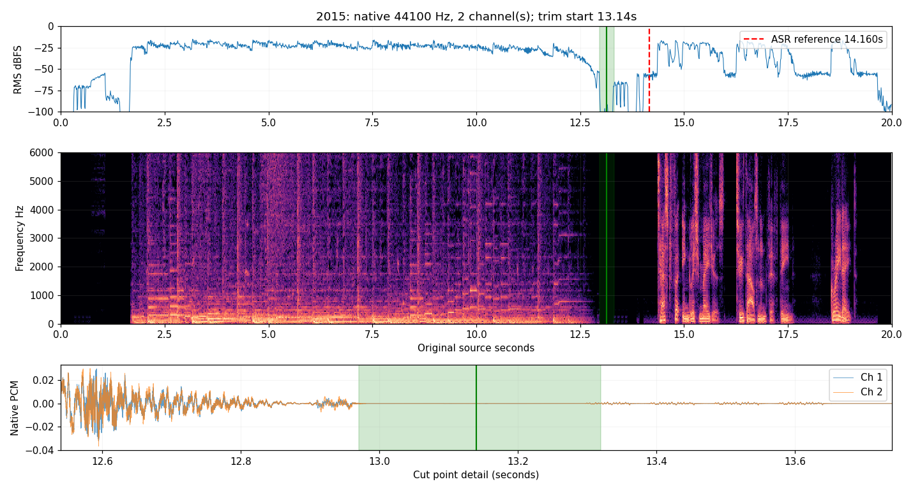

## 2016

逐年查看0—7s原采样率波形和0—6kHz频谱：正式报幕前没有连续音乐谐波或音乐段，只有前导静音及录音底噪；保留完整开头，start=0。ASR仅作报幕内容定位参考，首词Test在2.72s；不据此删除前导部分。

canonical SHA256: `7fd09dd3352a14943e905c3fa282ed957f74bbf82e3e7368118f7e70da18d6c5`
原压缩文件 SHA256: `49dbb25f5b95c4abd9ea8485878481f1101644f3b777dfdc3f43c6ffa8d19eb3`

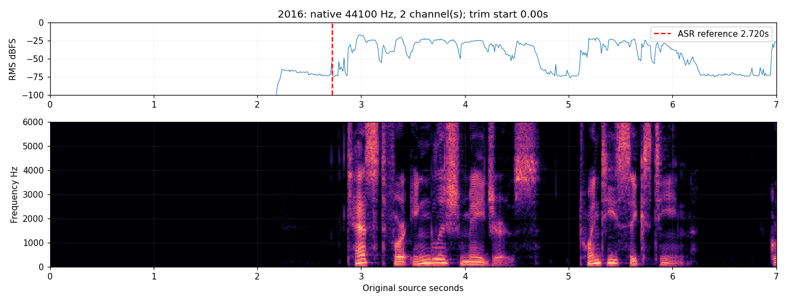

## 2017

逐年查看0—7s原采样率波形和0—6kHz频谱：正式报幕前没有连续音乐谐波或音乐段，只有前导静音及录音底噪；保留完整开头，start=0。ASR仅作报幕内容定位参考，首词Test在4.08s；不据此删除前导部分。

canonical SHA256: `a679fd3b8732a2c52107d074a3dd608f80dcbe38dfdc5625bbacfabb080a5c3e`
原压缩文件 SHA256: `80dbd0665d778cd9f07accb69d4aea0995f602cc4b75b79b77e0b5bab670c828`

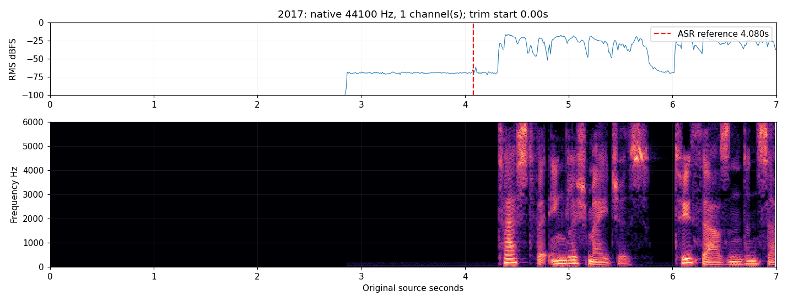

## 2018

逐年查看0—7s原采样率波形和0—6kHz频谱：正式报幕前没有连续音乐谐波或音乐段，只有前导静音及录音底噪；保留完整开头，start=0。ASR仅作报幕内容定位参考，首词Test在1.76s；不据此删除前导部分。

canonical SHA256: `959fe004fda2f647acee5dd8c7db79f5268c2d70aeabf6d7768c17471f7cdff8`
原压缩文件 SHA256: `79070314c10f09738c1ecb1340ca09bc5f3114152920acb58d4f76cf1eaf85d8`

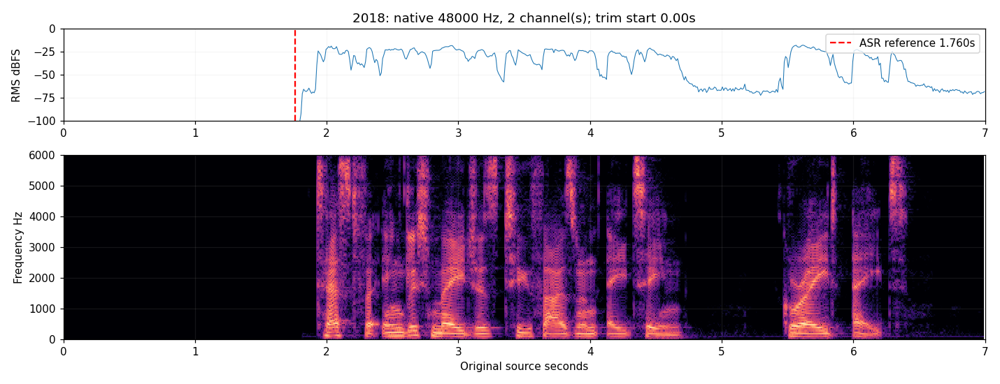

## 2019

逐年查看0—7s原采样率波形和0—6kHz频谱：正式报幕前没有连续音乐谐波或音乐段，只有前导静音及录音底噪；保留完整开头，start=0。ASR仅作报幕内容定位参考，首词Test在0.96s；不据此删除前导部分。

canonical SHA256: `b6659eec0e0035603eced5cf3cd58b614be9519fb34936ab78f350846c0ab283`
原压缩文件 SHA256: `e2f8634325ff1d2ab83fb18e93483bc0e419537c487720a7e70c88e21a296902`

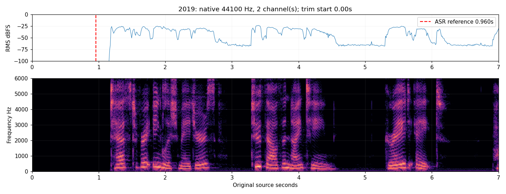

## 2021

逐年查看0—7s原采样率波形和0—6kHz频谱：正式报幕前没有连续音乐谐波或音乐段，只有前导静音及录音底噪；保留完整开头，start=0。ASR仅作报幕内容定位参考，首词Test在1.28s；不据此删除前导部分。

canonical SHA256: `a9701c485a209512978c089a10a20b73e4a7e4ef34ebd209c1dddb4a28390701`
原压缩文件 SHA256: `f022cf43bee44471625c25828ba574b28b70e9001edf45622c691a230acd9b17`

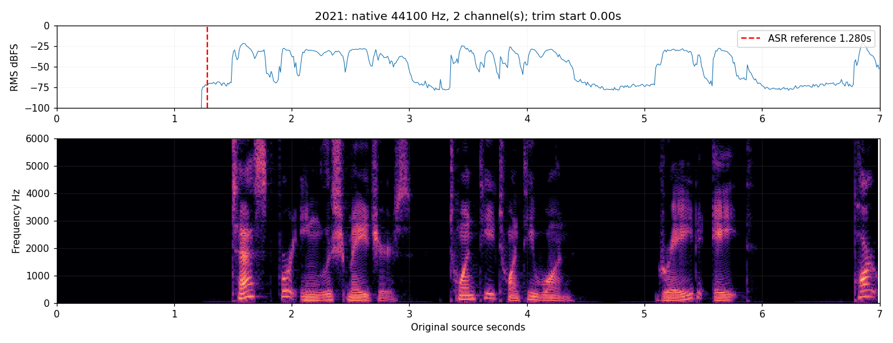

## 2023

逐年查看0—7s原采样率波形和0—6kHz频谱：正式报幕前没有连续音乐谐波或音乐段，只有前导静音及录音底噪；保留完整开头，start=0。ASR仅作报幕内容定位参考，首词Test在1.60s；不据此删除前导部分。

canonical SHA256: `5456ebb4af7760ba0e1a3daa51c4bf334f7e585f10ad325b18c979b9867c19ce`
原压缩文件 SHA256: `99911c342fb4b65fab0eb58ab7ef3fff4f9300224a0e711e102ccf7bf8d43618`

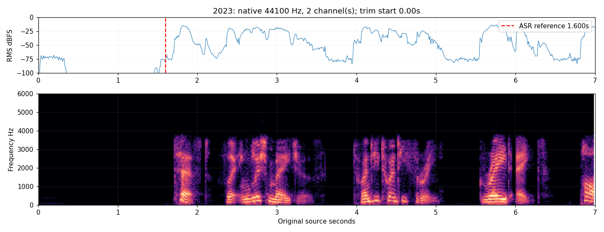

## 2024

逐年查看0—7s原采样率波形和0—6kHz频谱：正式报幕前没有连续音乐谐波或音乐段，只有前导静音及录音底噪；保留完整开头，start=0。ASR仅作报幕内容定位参考，首词Test在1.12s；不据此删除前导部分。本源约0.1s后的波形基线为直流偏置，非音乐；不消除偏置、不作音量或声道处理。

canonical SHA256: `6624d7334f190e6073e86b7424b4d25b0fbbc7729e94daaef2c09f4d2228a213`
原压缩文件 SHA256: `99fc32a4bc452a6923b86e493b7f989f4852f6159359239b059fc1a17fd666b8`

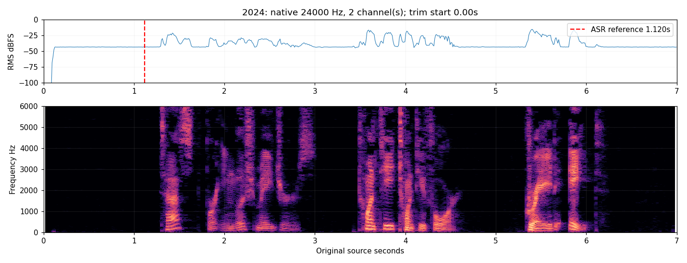
